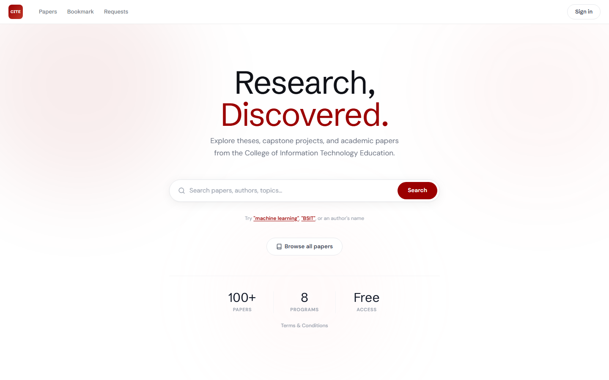
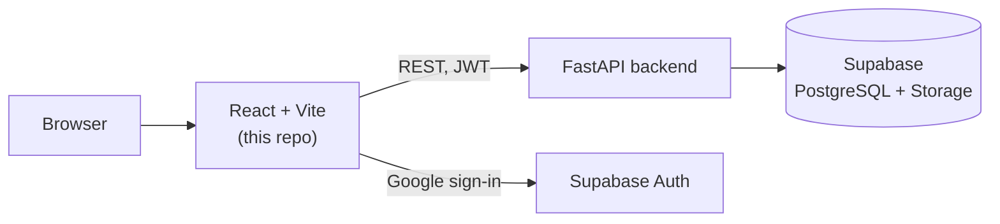

# CITE-TMS

**A thesis and research repository for the College of Information Technology and Engineering at De La Salle Lipa.** Students can find prior work by meaning, not only exact keywords, and authors control who can read their full papers.

[](https://github.com/gncrlatienza-eng/cite-tms-frontend/actions/workflows/ci.yml)

This is the React frontend. The API and search engine live in [cite-tms-backend](https://github.com/gncrlatienza-eng/cite-tms-backend).



## Why

Past theses are hard to discover when they sit in folders and on shelves, and a keyword search misses papers that describe the same idea in different words. CITE-TMS puts them in one searchable place and gives each paper's author a say in who gets full access.

## Features

| Role | What they can do |
|---|---|
| **Student** | Browse and filter papers, search by topic, bookmark papers, request full-text access, submit a paper |
| **Author** | Manage their own papers and approve or decline access requests |
| **Admin** | Manage papers and users, review upload and author requests, and maintain the whitelist |

Sign-in uses Google through Supabase, with a role-aware redirect after login and a terms acceptance step for new users.

## Architecture



| Area | Stack |
|---|---|
| UI | React 19, Vite, Tailwind CSS, lucide-react |
| State and routing | Zustand, React Context, React Router |
| Data | axios, Supabase client |
| Hosting | Vercel |

## Project layout

```text
src/
  pages/        public, protected, student, author and admin screens
  routes/       guards for author and admin areas
  context/      signed-in user state
  services/     API and Supabase clients
  components/   shared layout, search and paper components
```

## Run it locally

```bash
npm install
cp .env.example .env    # then fill in the values
npm run dev
```

| Variable | Purpose |
|---|---|
| `VITE_API_URL` | Backend URL. Defaults to `http://127.0.0.1:8000` |
| `VITE_SUPABASE_URL` | Supabase project URL |
| `VITE_SUPABASE_ANON_KEY` | Supabase public anon key |

## Quality

`npm run lint` and `npm run build` run in CI on every push and pull request. ESLint currently treats some older findings as warnings so CI can stay useful while they are cleaned up.

## Team

| Member | Main work |
|---|---|
| [Gian Carlo Atienza](https://github.com/gncrlatienza-eng) | Sign-in and roles, admin dashboard, search integration, deployment |
| [Ernalene Rocha](https://github.com/ernarocha) | Paper browsing, landing page, author dashboard, bookmarks, navigation |
| [Georgina Ramos](https://github.com/erianthe17) | Paper upload, My Papers, paper preview |
